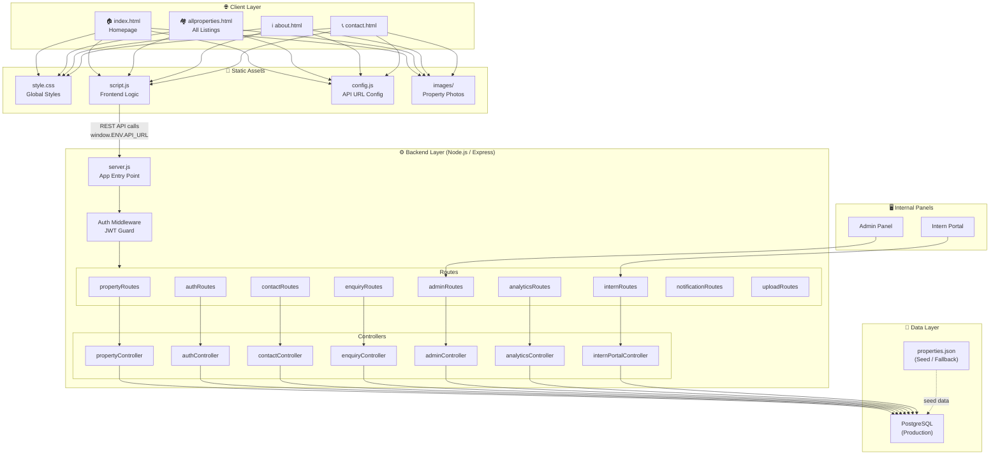
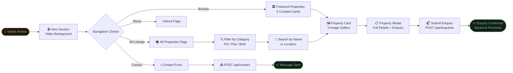
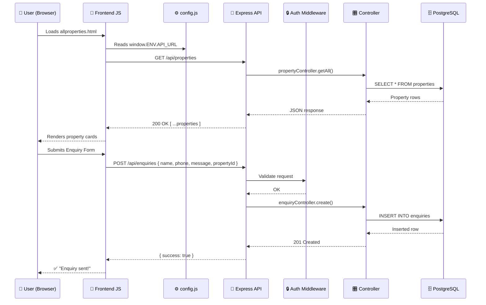
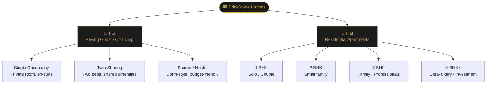
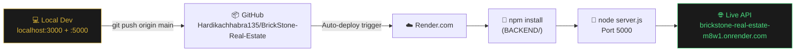
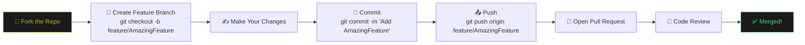

<div align="center">

# 🏛️ BRICKSTONE
### *Curated Properties. Timeless Value.*

<br/>

[](https://nodejs.org/)
[](https://expressjs.com/)
[](https://developer.mozilla.org/en-US/docs/Web/JavaScript)
[](https://html.spec.whatwg.org/)
[](https://www.w3.org/Style/CSS/)
[](https://render.com/)
[](https://jwt.io/)

<br/>

> **BrickStone** is a full-stack premium real estate platform for Delhi & NCR, offering curated luxury PG accommodations and high-end residential flats — combining an editorial aesthetic with a powerful, production-ready Node.js backend.

<br/>

[🌐 Live Demo](https://brickstone-real-estate-m8w1.onrender.com) · [📋 Report Bug](https://github.com/Hardikachhabra135/BrickStone-Real-Estate/issues) · [💡 Request Feature](https://github.com/Hardikachhabra135/BrickStone-Real-Estate/issues)

---

</div>

<br/>

## 📖 Table of Contents

- [✨ About the Project](#-about-the-project)
- [🗺️ System Architecture](#️-system-architecture)
- [🧭 User Journey](#-user-journey)
- [📡 Data Flow](#-data-flow)
- [🗂️ Project Structure](#️-project-structure)
- [🛠️ Tech Stack](#️-tech-stack)
- [🏠 Property Categories](#-property-categories)
- [📦 Featured Listings](#-featured-listings)
- [📡 API Reference](#-api-reference)
- [⚙️ Getting Started](#️-getting-started)
- [🚀 Deployment](#-deployment)
- [🔐 Environment Variables](#-environment-variables)
- [🤝 Contributing](#-contributing)
- [📄 License](#-license)

---

## ✨ About the Project

BrickStone is not just a property listing site — it's a **luxury real estate experience platform** purpose-built for the discerning Delhi & NCR market. Every pixel, every property card, every backend route is designed to reflect one truth: *premium matters*.

### 🌟 Core Highlights

| Feature | Description |
|---|---|
| 🎬 **Cinematic Hero** | Full-viewport looping video background with glassmorphism overlay |
| 🏘️ **6 Featured Listings** | Hand-curated premium PGs & flats with multi-image galleries |
| 🔍 **Smart Search** | Real-time universal search across all property listings |
| 🏷️ **Category Filters** | One-click filter by PG / Flat / BHK / Sharing type |
| 🖼️ **Lightbox Gallery** | Per-property 3-image carousel with full-screen lightbox |
| 📬 **Enquiry System** | Backend-persisted enquiry & contact form pipeline |
| 🔒 **Auth System** | JWT-based admin authentication with role guards |
| 📊 **Analytics Routes** | Built-in analytics event tracking for property views |
| 👤 **Admin Panel** | Full CRUD management panel for listings |
| 🎓 **Intern Portal** | Dedicated workflow portal for interns |
| 📱 **Fully Responsive** | Mobile-first hamburger nav + adaptive grid layout |
| ☁️ **Cloud Deployed** | One-click Render.com deployment via `render.yaml` |

---

## 🗺️ System Architecture



---

## 🧭 User Journey



---

## 📡 Data Flow



---

## 🗂️ Project Structure

```
BrickStone-Real-Estate/
│
├── 📁 FRONTEND/                    # Static website (served on port 3000)
│   ├── index.html                  # Homepage — hero, featured properties
│   ├── allproperties.html          # All listings — search + filter
│   ├── about.html                  # About BrickStone
│   ├── contact.html                # Contact form page
│   ├── style.css                   # Global stylesheet (v=9)
│   ├── script.js                   # All frontend JavaScript
│   ├── config.js                   # window.ENV.API_URL configuration
│   └── images/                     # Property photos (20+ real/AI images)
│       ├── delhi-gk-pg-room.jpg
│       ├── delhi-ivy-pg-room.jpg
│       ├── delhi-flat-golflinks-*.jpg
│       ├── delhi-ncr-flat-camellias-*.jpg
│       └── ...
│
├── 📁 BACKEND/                     # Express.js REST API (port 5000)
│   ├── server.js                   # App entry, middleware, route mounting
│   ├── setup.js                    # DB setup / seeding
│   ├── properties.json             # Property seed data (6 featured + more)
│   ├── interns.json                # Intern data
│   ├── messages.json               # Contact messages store
│   │
│   ├── 📁 config/                  # DB connection config
│   ├── 📁 middleware/              # Auth middleware (JWT verify)
│   │
│   ├── 📁 routes/                  # Express route definitions
│   │   ├── propertyRoutes.js       # GET /api/properties, POST, PUT, DELETE
│   │   ├── auth.js                 # POST /api/auth/login, /register
│   │   ├── contactRoutes.js        # POST /api/contact
│   │   ├── enquiryRoutes.js        # POST /api/enquiries
│   │   ├── adminRoutes.js          # Admin CRUD (protected)
│   │   ├── analyticsRoutes.js      # Event tracking
│   │   ├── internRoutes.js         # Intern management
│   │   ├── notificationRoutes.js   # Notifications
│   │   └── uploadRoutes.js         # Image upload (multer)
│   │
│   └── 📁 controllers/             # Business logic
│       ├── propertyController.js
│       ├── authController.js
│       ├── contactController.js
│       ├── enquiryController.js
│       ├── adminController.js
│       ├── analyticsController.js
│       ├── internPortalController.js
│       ├── notificationController.js
│       └── siteController.js
│
├── 📁 ADMIN_PANEL/                 # Admin dashboard (CRUD for listings)
├── 📁 INTERN_PORTAL/               # Intern workflow portal
│
├── serve_all.js                    # Dev server (frontend :3000 + backend :5000)
├── package.json                    # Root scripts & dependencies
├── render.yaml                     # Render.com deployment config
└── README.md                       # You're reading it ✨
```

---

## 🛠️ Tech Stack

### Frontend
| Technology | Role |
|---|---|
| **HTML5** | Semantic structure, SEO-friendly markup |
| **CSS3** | Custom properties, Flexbox, Grid, Glassmorphism, animations |
| **Vanilla JS (ES6+)** | DOM manipulation, IntersectionObserver, fetch API |
| **CSS `backdrop-filter`** | Frosted-glass nav and card overlays |

### Backend
| Technology | Role |
|---|---|
| **Node.js** | JavaScript runtime |
| **Express.js** | REST API framework |
| **JWT** | Stateless admin authentication |
| **Multer** | Multipart image upload handling |
| **PostgreSQL** | Production relational database |
| **JSON files** | Seed data / development fallback |

### DevOps & Tooling
| Tool | Role |
|---|---|
| **Render.com** | Cloud hosting (backend API) |
| **render.yaml** | Infrastructure-as-code deployment |
| **Git / GitHub** | Version control & CI/CD trigger |
| **Windows Credential Manager** | Secure local git auth |

---

## 🏠 Property Categories



---

## 📦 Featured Listings

| # | Property | Location | Type | Price |
|---|---|---|---|---|
| 1 | **Aura Luxury PG** | Greater Kailash, New Delhi | PG · Single | ₹25,000/mo |
| 2 | **The Ivy House PG** | Hauz Khas, New Delhi | PG · Single | ₹22,000/mo |
| 3 | **The Camellias Sky Residence** | Golf Course Rd, Gurugram | Flat · 4BHK | ₹12.5 Cr |
| 4 | **The Vasant Vihar Residence** | Vasant Vihar, Delhi | Flat · 4BHK | ₹8.5 Cr |
| 5 | **The Golf Links Manor** | Golf Links, Delhi | Flat · 3BHK | ₹6.2 Cr |
| 6 | **The Arbour Executive PG** | DLF Cyber City, Gurugram | PG · Twin | ₹26,000/mo |

---

## 📡 API Reference

Base URL: `https://brickstone-real-estate-m8w1.onrender.com/api`

### Properties

| Method | Endpoint | Auth | Description |
|---|---|---|---|
| `GET` | `/properties` | ❌ | Get all property listings |
| `GET` | `/properties/:id` | ❌ | Get single property by ID |
| `POST` | `/properties` | ✅ Admin | Create a new listing |
| `PUT` | `/properties/:id` | ✅ Admin | Update a listing |
| `DELETE` | `/properties/:id` | ✅ Admin | Delete a listing |

### Auth

| Method | Endpoint | Auth | Description |
|---|---|---|---|
| `POST` | `/auth/login` | ❌ | Admin login → returns JWT |
| `POST` | `/auth/register` | ❌ | Register new admin |

### Enquiries & Contact

| Method | Endpoint | Auth | Description |
|---|---|---|---|
| `POST` | `/enquiries` | ❌ | Submit property enquiry |
| `GET` | `/enquiries` | ✅ Admin | View all enquiries |
| `POST` | `/contact` | ❌ | Submit contact message |
| `GET` | `/contact` | ✅ Admin | View all messages |

### Analytics

| Method | Endpoint | Auth | Description |
|---|---|---|---|
| `POST` | `/analytics` | ❌ | Log property view event |
| `GET` | `/analytics` | ✅ Admin | Get analytics summary |

### Image Upload

| Method | Endpoint | Auth | Description |
|---|---|---|---|
| `POST` | `/upload` | ✅ Admin | Upload property image (multipart) |

---

## ⚙️ Getting Started

### Prerequisites

- Node.js `v18+`
- npm `v9+`
- PostgreSQL (for production) or JSON fallback (for dev)

### 1. Clone the Repository

```bash
git clone https://github.com/Hardikachhabra135/BrickStone-Real-Estate.git
cd BrickStone-Real-Estate
```

### 2. Install Dependencies

```bash
# Install root (dev server) deps
npm install

# Install backend deps
cd BACKEND && npm install && cd ..
```

### 3. Configure Environment

Create `BACKEND/.env`:

```env
PORT=5000
NODE_ENV=development
JWT_SECRET=your_super_secret_key_here

# PostgreSQL (optional for local dev)
DB_HOST=localhost
DB_USER=postgres
DB_PASSWORD=yourpassword
DB_NAME=brickstone
DB_PORT=5432
DB_SSL=false

FRONTEND_URL=http://localhost:3000
```

Configure frontend API URL in `FRONTEND/config.js`:

```javascript
window.ENV = {
  API_URL: "http://localhost:5000"   // dev
  // API_URL: "https://brickstone-real-estate-m8w1.onrender.com"  // prod
};
```

### 4. Run the App

```bash
# Start both frontend (port 3000) and backend (port 5000)
npm start
```

Or run them separately:

```bash
# Terminal 1 — Backend
npm run backend

# Terminal 2 — Frontend dev server
node serve_all.js
```

Open [http://localhost:3000](http://localhost:3000) in your browser. 🎉

---

## 🚀 Deployment

BrickStone uses **Render.com** for cloud deployment, driven by the `render.yaml` infrastructure-as-code file.



### Steps to Deploy

1. **Fork** this repository to your GitHub account
2. **Create a new Web Service** on [Render.com](https://render.com) → connect GitHub repo
3. Set **Root Directory** to `BACKEND`
4. Set **Start Command** to `npm start`
5. Add the environment variables listed below
6. Hit **Deploy** — Render picks up `render.yaml` automatically

---

## 🔐 Environment Variables

| Variable | Required | Description |
|---|---|---|
| `PORT` | ✅ | Server port (default: `5000`) |
| `NODE_ENV` | ✅ | `production` or `development` |
| `JWT_SECRET` | ✅ | Secret key for JWT signing |
| `DB_HOST` | ✅ | PostgreSQL host |
| `DB_USER` | ✅ | PostgreSQL username |
| `DB_PASSWORD` | ✅ | PostgreSQL password |
| `DB_NAME` | ✅ | Database name |
| `DB_PORT` | ✅ | PostgreSQL port (default: `5432`) |
| `DB_SSL` | ✅ | Enable SSL (`true` / `false`) |
| `CA_CERT_PATH` | ⚙️ | Path to SSL CA cert (if `DB_SSL=true`) |
| `FRONTEND_URL` | ✅ | CORS allowed origin (`*` for public) |

---

## 🤝 Contributing

Contributions are what make the open source community such an amazing place. Any contributions you make are **greatly appreciated**.



1. Fork the Project
2. Create your Feature Branch (`git checkout -b feature/AmazingFeature`)
3. Commit your Changes (`git commit -m 'feat: Add AmazingFeature'`)
4. Push to the Branch (`git push origin feature/AmazingFeature`)
5. Open a Pull Request

### Commit Convention

We follow **Conventional Commits**:

| Prefix | When to use |
|---|---|
| `feat:` | A new feature |
| `fix:` | A bug fix |
| `docs:` | Documentation only changes |
| `style:` | Formatting, missing semi-colons, etc |
| `refactor:` | Code change that neither fixes a bug nor adds a feature |
| `chore:` | Build process or auxiliary tool changes |

---

## 📄 License

Distributed under the **MIT License**. See [`LICENSE`](LICENSE) for more information.

---

<div align="center">

<br/>

**Built with ❤️ for the Delhi & NCR premium real estate market**

*© 2025 BrickStone Real Estate · Curated Properties. Timeless Value.*

<br/>

[](https://github.com/Hardikachhabra135/BrickStone-Real-Estate/stargazers)
[](https://github.com/Hardikachhabra135/BrickStone-Real-Estate/network/members)

</div>
